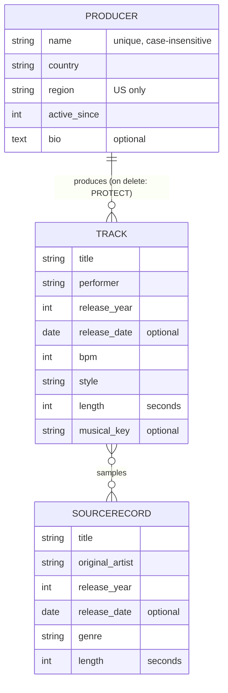

# SampleTracer

**Trace hip hop back to its source records.**

SampleTracer is a small Django web app for hip hop producers and crate diggers. You log *producers*, the *tracks* they made and the *source records* those tracks sample, then follow the sample chain in either direction: from a track to the records it flips, or from a record to every track that flipped it.

Built as the individual project for the **Django Basics** course. There is no authentication by design.

---

## Table of contents

- [Features](#features)
- [Tech stack](#tech-stack)
- [Getting started](#getting-started)
- [Configuration and environment variables](#configuration-and-environment-variables)
- [Seeing the custom 404 page](#seeing-the-custom-404-page)
- [Quick tour for evaluators](#quick-tour-for-evaluators)
- [Data model](#data-model)
- [Pages and routes](#pages-and-routes)
- [Validation and business rules](#validation-and-business-rules)
- [Project structure](#project-structure)
- [Templates and design](#templates-and-design)
- [Requirements coverage](#requirements-coverage)

---

## Features

- **Producers**: full CRUD (list, details, create, edit, delete with confirmation).
- **Tracks**: full CRUD, each linked to one producer and any number of sampled records. The producer is locked (disabled field) when editing.
- **Source records**: list, details and create. Records are the reference data that tracks sample.
- **Sample chain**: a track page lists its samples; a record page lists every track that samples it.
- **Most sampled**: a leaderboard that ranks only source records sampled by at least one track; ties are ordered consistently.
- **Search, filter and sort tracks** through a GET form. Filter by title, performer, style, release-year range, producer and sampled record; sort by release year, title, BPM or length. Pagination keeps the active filters.
- **Pagination** on the track list.
- **Form validation**: contextual labels, help text, placeholders and custom error messages where appropriate, including cross-field checks.
- **Messages framework** feedback after create, edit and delete.
- **Custom 404 page** and a custom `duration` template filter.
- Starts with an **empty database**: everything is created through the UI, no fixtures or seed data.

## Tech stack

| Part | Choice |
|---|---|
| Language | Python 3.12 or newer |
| Framework | Django 6.1 |
| Database | SQLite (default, zero setup) |
| Static files | WhiteNoise, so the CSS also loads with `DEBUG = False` |
| Front end | Django templates and hand-written CSS, no JavaScript framework |

Pinned dependencies are in [`requirements.txt`](requirements.txt).

---

## Getting started

You need **Python 3.12+** and **git**. No database server and no credentials are needed for local development. The defaults are development-only and are not safe for a public production deployment.

### 1. Clone the repository

```bash
git clone https://github.com/NikolayVasMarinov/SampleTracer.git
cd SampleTracer
```

### 2. Create and activate a virtual environment

Windows (PowerShell):

```powershell
python -m venv .venv
.venv\Scripts\Activate.ps1
```

Windows (cmd):

```bat
python -m venv .venv
.venv\Scripts\activate.bat
```

macOS / Linux:

```bash
python3 -m venv .venv
source .venv/bin/activate
```

### 3. Install the dependencies

```bash
pip install -r requirements.txt
```

### 4. Create the database

```bash
python manage.py migrate
```

This creates `db.sqlite3` in the project root with empty tables.

### 5. Run the server

```bash
python manage.py runserver
```

Open <http://127.0.0.1:8000/>. The app is fully usable at this point: start with **+ Add -> Producer** in the navbar.

---

## Configuration and environment variables

**No environment variables or credentials are required.** The project runs on its default configuration:

| Setting | Default |
|---|---|
| Database | SQLite file `db.sqlite3` in the project root |
| `DEBUG` | `True` |
| `ALLOWED_HOSTS` | `["*"]` (local evaluation only) |
| `SECRET_KEY` | Development key in `sampletracer/settings.py` |
| Users / admin | No login is needed for the application. `/admin/` requires a Django superuser and is not part of the intended workflow. |

To start from a clean slate at any time, stop the server, delete `db.sqlite3` and run `python manage.py migrate` again.

**Deployment warning:** do not publish the app with these defaults. The project has `DEBUG = True`, a development `SECRET_KEY`, and a wildcard host setting. For production, use a strong secret loaded from the environment, set `DEBUG = False`, restrict `ALLOWED_HOSTS`, configure HTTPS/security settings and run `python manage.py check --deploy`.

---

## Seeing the custom 404 page

While `DEBUG = True`, Django replaces the 404 page with its technical debug page. To see the custom `404.html`:

1. In `sampletracer/settings.py`, set `DEBUG = False`.
2. Collect the static files (needed so the CSS loads without debug mode; they are served by WhiteNoise from the git-ignored `staticfiles/` folder):

   ```bash
   python manage.py collectstatic --noinput
   ```

3. Restart `python manage.py runserver`.
4. Open any address that doesn't exist, for example <http://127.0.0.1:8000/nope/> or <http://127.0.0.1:8000/producers/9999/>.

WhiteNoise is configured in `MIDDLEWARE`, so after `collectstatic` the CSS can be served while `DEBUG = False`. This procedure is for local verification of the custom 404 page, not a production deployment recipe. Set `DEBUG` back to `True` afterwards for normal development.

---

## Quick tour for evaluators

Every object can be created through the interface using only the navigation links. A suggested order, because of the relationships between the models:

1. **Add a producer** (**+ Add -> Producer**). Try *United Kingdom* with a region, or *USA* without one, to see the validation messages.
2. **Add one or two source records** (**+ Add -> Source record**). Lengths are typed as `m:ss`, for example `3:45`.
3. **Log a track** (**+ Add -> Track**). Pick the producer and tick the records it samples. Try ticking a record released *after* the track to see the cross-field check.
4. **Browse** through the navbar: *Tracks* (search, filter, sort, pagination), *Producers*, *Source records* and *Most sampled*.
5. **Open a track** to see its sample chain, then **edit** it (the producer field is disabled) and **delete** it (confirmation page first).
6. **Try to delete a producer that still has tracks**: the confirmation page explains why it is blocked.

---

## Data model



- **Many-to-one**: `Track.producer` -> `Producer`, `related_name="tracks"`, `on_delete=PROTECT`.
- **Many-to-many**: `Track.samples` <-> `SourceRecord`, `related_name="tracks"`.

### Producer (`producers` app)

| Field | Details |
|---|---|
| `name` | max 40 characters; unique ignoring case (`Lower()` constraint) |
| `country` | choices: USA, United Kingdom, France, Brazil, Nigeria, Other |
| `region` | required for USA producers and forbidden for other countries; choices: West Coast, East Coast, Midwest, South, Other |
| `active_since` | year, 1900 to the current year |
| `bio` | optional text |
| `created_at`, `updated_at` | set automatically |

### SourceRecord (`records` app)

| Field | Details |
|---|---|
| `title` | max 50 characters |
| `original_artist` | max 45 characters |
| `release_year` | year, 1900 to the current year |
| `release_date` | optional; its year must match `release_year` |
| `genre` | choices: Soul, Jazz, Funk, Disco, R&B, Electronic, Pop, Rock, Reggae, Afrobeat, Latin, Other |
| `length` | stored in seconds, 1 second to 20 minutes |
| `slug` | built automatically on save, not editable |
| constraint | `title` + `original_artist` unique ignoring case |

### Track (`tracks` app)

| Field | Details |
|---|---|
| `title`, `performer` | max 50 characters each |
| `release_year` | year, 1900 to the current year |
| `release_date` | optional; its year must match `release_year` |
| `bpm` | 40 to 225 |
| `style` | choices: Boom Bap, Trap, Drill, G-Funk, Conscious, Jazz Rap, Cloud Rap, Alternative, Other |
| `length` | stored in seconds, 1 second to 20 minutes |
| `musical_key` | optional; 24 major and minor keys |
| `producer` | required foreign key (see above) |
| `samples` | optional many-to-many to `SourceRecord` |
| `slug` | built automatically on save, not editable |
| constraint | `title` + `performer` unique ignoring case |

Models define default ordering: producers by name, source records by release year then title and `pk`, and tracks by newest release year then title and `pk`. The `pk` tiebreaker keeps record and track ordering stable for pagination.

---

## Pages and routes

| URL | Name | Page |
|---|---|---|
| `/` | `home` | Home: counters and the latest tracks |
| `/about/` | `about` | About the project |
| `/most_sampled/` | `most_sampled` | Source records ranked by times sampled |
| `/producers/` | `producers:list` | All producers |
| `/producers/create/` | `producers:create` | Add a producer |
| `/producers/<id>/` | `producers:detail` | Producer details and their tracks |
| `/producers/<id>/edit/` | `producers:edit` | Edit a producer |
| `/producers/<id>/delete/` | `producers:delete` | Delete confirmation |
| `/records/` | `records:list` | All source records |
| `/records/create/` | `records:create` | Add a source record |
| `/records/<slug>/` | `records:detail` | Record details and the tracks that sample it |
| `/tracks/` | `tracks:list` | All tracks: search, filter, sort, pagination |
| `/tracks/create/` | `tracks:create` | Log a track |
| `/tracks/<slug>/` | `tracks:detail` | Track details and sample chain |
| `/tracks/<slug>/edit/` | `tracks:edit` | Edit a track (producer locked) |
| `/tracks/<slug>/delete/` | `tracks:delete` | Delete confirmation |

The application workflow is reachable from the navbar, the footer or links inside other pages. The `/admin/` route is configured, but SampleTracer models are not registered there; normal app use needs no account, while admin access requires a Django superuser.

---

## Validation and business rules

Forms run Django model validation before saving, while database constraints enforce uniqueness and foreign-key protection. Model `save()` calls alone do not automatically run `clean()`.

- **Years** must be between 1900 and the current year.
- **Release date and year** must agree when both are given (tracks and records).
- **Length** is typed as `m:ss` (for example `3:45`), validated for format and range (longer than 0 seconds, at most 20 minutes), stored as seconds and displayed as `m:ss` through the `duration` filter.
- **Producer region** can only be set when the country is USA, and is required for USA producers.
- **A track cannot sample a record released after the track** (checked by year, then by full date when both exist). The error is shown on the samples field.
- **Duplicates** are rejected ignoring case: producer names, records by title and original artist, tracks by title and performer. Slugs are unique too; if different title/artist pairs normalize to the same slug, the form reports a URL collision instead of letting the database raise an unhandled integrity error.
- **A producer with tracks cannot be deleted** (`PROTECT`); the confirmation page explains it and hides the delete button, and the view also handles a direct/racing POST safely.
- **The producer of an existing track cannot be changed**: the field is disabled on the edit form.
- Forms use `novalidate` so the server-side messages are always shown.

---

## Project structure

```
SampleTracer/
├── manage.py
├── requirements.txt
├── sampletracer/            # project: settings, root URLs, wsgi/asgi
├── core/                    # shared code: home, about, most sampled
│   ├── constants.py         #   max length in seconds
│   ├── validators.py        #   validate_year
│   ├── utils.py             #   parse_length / format_length (m:ss <-> seconds)
│   ├── templatetags/
│   │   └── duration.py      #   custom template filter
│   └── static/core/css/style.css
├── producers/               # Producer model, form, views, URLs
├── records/                 # SourceRecord model, form, views, URLs
├── tracks/                  # Track model, forms, views, URLs
└── templates/
    ├── base.html            # layout: navbar, messages, footer
    ├── 404.html             # custom not-found page
    ├── partials/            # reusable includes (navbar, footer, forms, tables, cards, pagination)
    ├── core/                # home, about, most sampled
    ├── producers/           # list, detail, form, delete
    ├── records/             # list, detail, form
    └── tracks/              # list, detail, form, delete
```

Responsibilities are kept separate: each app owns its model, form, views and URLs; `core` holds the code that more than one app uses (validators, length helpers, the template filter).

---

## Templates and design

- **28 template files**: one base template, the custom 404, 14 page templates and 12 reusable partials. The 14 page templates are the three core pages, four producer pages, three source-record pages and four track pages. Producer and track create/edit flows share their form template; source records have create/list/detail pages only.
- **Inheritance**: every page extends `base.html`, which provides the navbar, the messages area and the footer.
- **Partials** (`templates/partials/`): navbar, footer, messages, page header, empty state, form field, form body, pagination, track table, record table, producer card and sample chips.
- **Template tags and filters**: the custom `duration` filter, plus built-ins such as `url`, `querystring`, `pluralize`, `truncatechars`, `timesince`, `date`, `linebreaks`, `now` and `with`.
- **Design**: hand-written CSS, a warm "liner notes" look with responsive tables, cards and forms. No external fonts, images or CDNs, so it works offline.

---

## Requirements coverage

| Requirement | Where |
|---|---|
| 3+ apps | `core`, `producers`, `records`, `tracks` |
| 3+ models, many-to-one and many-to-many | `Producer`, `SourceRecord`, `Track`; FK `Track.producer`, M2M `Track.samples` |
| Full CRUD on 2+ models | Producers and tracks; records can be created, listed and viewed |
| 3+ forms with validation | `ProducerForm`, `SourceRecordForm`, `TrackForm`, `TrackEditForm`, `TrackFilterForm` |
| Labels, help texts, placeholders and custom validation messages | Producer, source-record, track and track-filter forms |
| Disabled field, excluded fields | `producer` on `TrackEditForm`; `exclude` on `TrackForm` |
| Cross-field validation | Region vs country, samples vs track release, release date vs year, and track-filter year range |
| Delete confirmation | Producers and tracks |
| 10+ templates, 7+ dynamic, base and partials | See [Templates and design](#templates-and-design) |
| Custom template filter | `duration` |
| Custom 404 | `templates/404.html` |
| Redirect after successful forms | Create, edit and delete views |
| Search/filter and pagination | Track list |
| No authentication, empty database at start | No user features, no fixtures |
